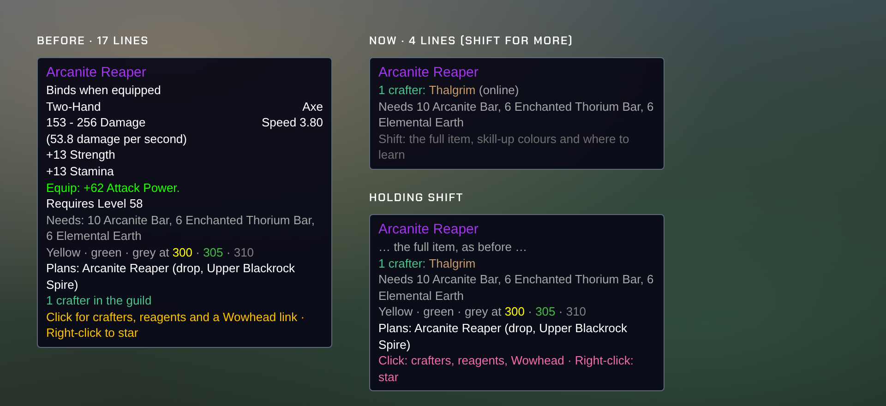
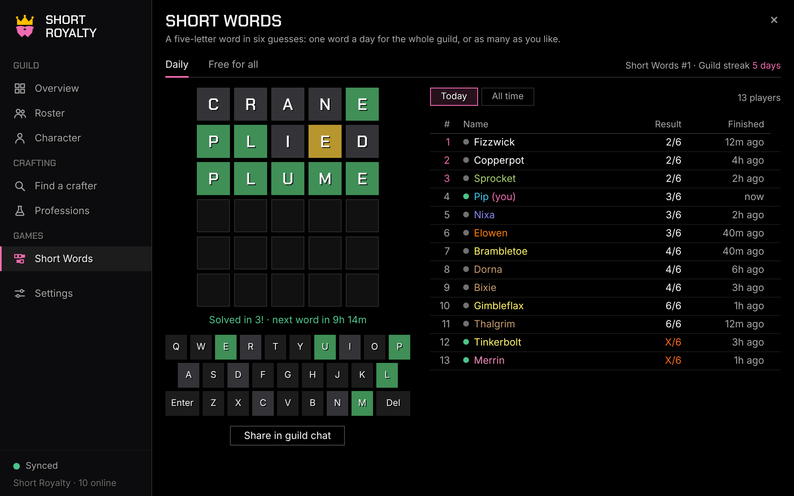
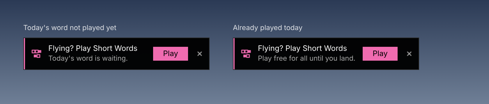
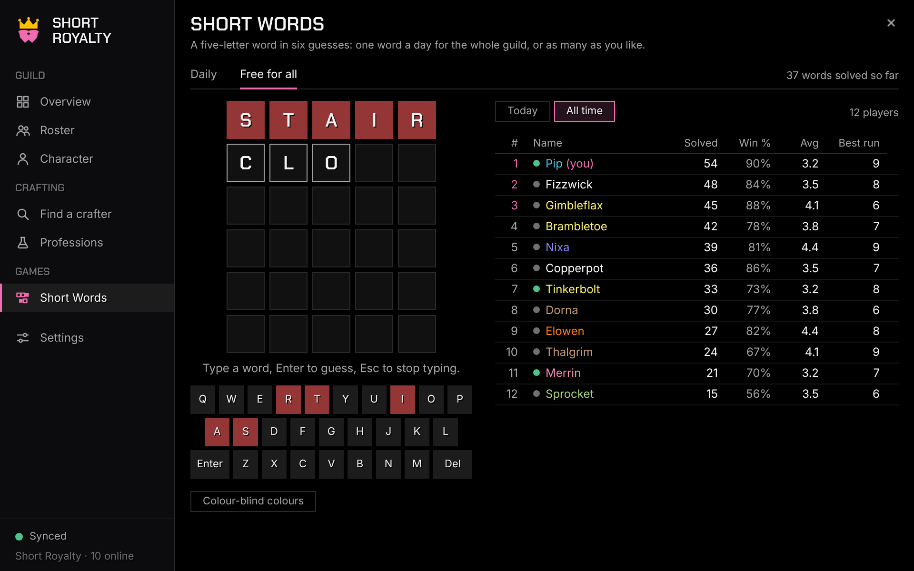
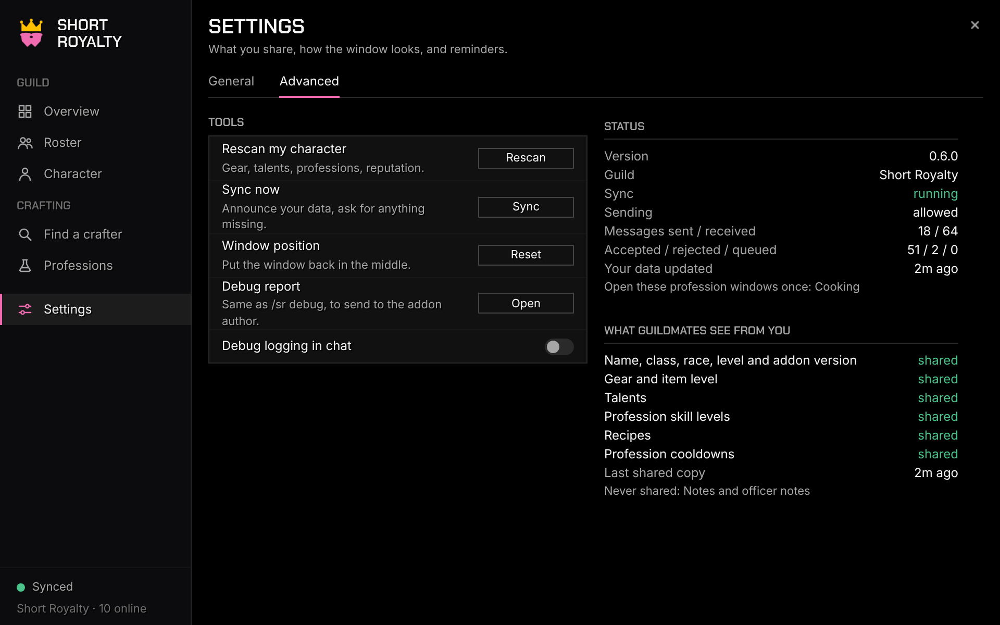
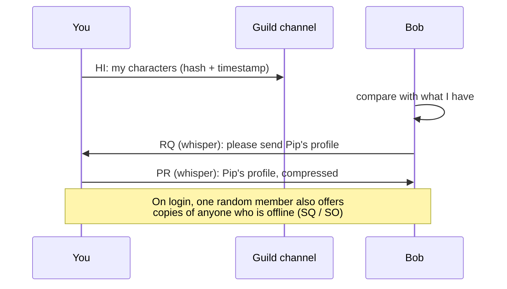
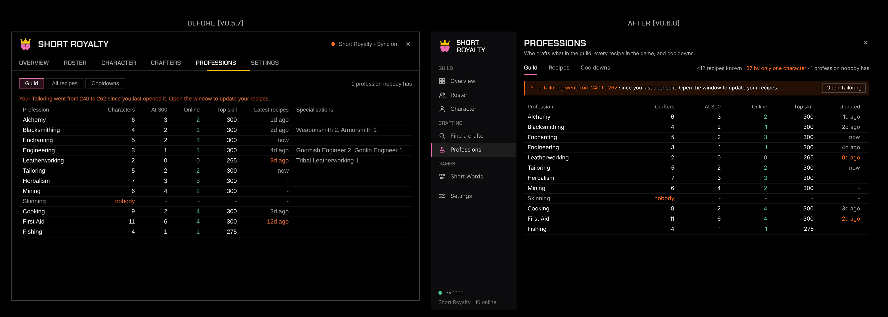
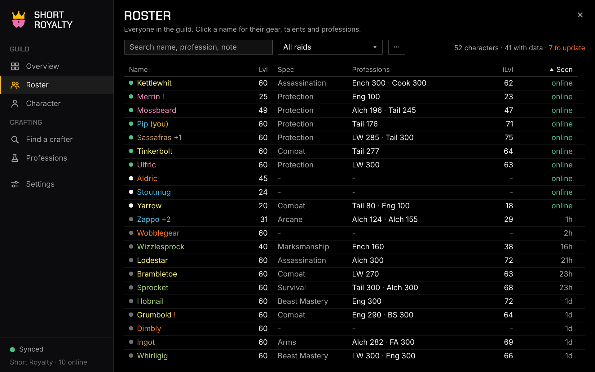
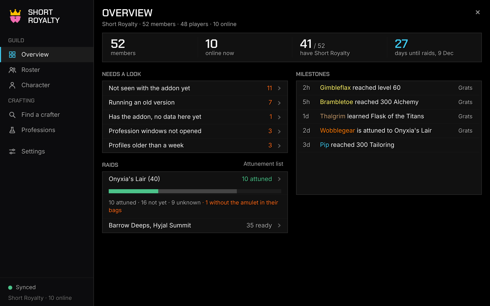

<p align="center">
  
</p>

<p align="center">
  <a href="https://github.com/EllisKOsborn/forever-shortroyalty/actions/workflows/ci.yml"></a>
  
  
  
</p>

<p align="center">
  <b>The guild addon for the Short Royalty of World of Warcraft: Forever.</b><br>
  Everyone's gear, talents, professions, recipes and raid readiness in one window.<br>
  No website, no server, no uploads: it all travels over the guild's addon channel.
</p>

<p align="center">
  <a href="#install">Install</a> ·
  <a href="#whats-inside">What's inside</a> ·
  <a href="#commands">Commands</a> ·
  <a href="#faq">FAQ</a> ·
  <a href="#roadmap">Roadmap</a> ·
  <a href="#the-look">The look</a>
</p>

> [!NOTE]
> **Used by the guild in game since launch (4 Nov 2026).** Each version is
> built against Blizzard's own Forever 1.60.1 interface code and tested
> against a simulated WoW client before it's released; what still needs
> checking in game is in [TESTING.md](TESTING.md). The pictures here are
> drawn by the [browser preview](preview/index.html) from the addon's real
> colours, fonts and layout. Item icons are placeholders; in game you see
> the real ones.

---

<a id="whats-inside"></a>

## 🧨 What's inside

| | What you get |
|---|---|
| 🏰 **Overview** | The guild at a glance: four numbers, what needs a look, raid readiness and recent milestones |
| 👥 **Roster** | The whole guild in one sortable, searchable list, with alts folded under mains and a raid-attunement view |
| 🛡️ **Character** | Anyone's gear, talents, professions, cooldowns, attunements and reputations |
| ⚒️ **Find a crafter** | Search an item or recipe and see who in the guild can make it, online first, with its reagents and your bag counts |
| 🧪 **Professions** | Three page tabs: **Guild** (every profession in the guild, then each profession's crafters and recipes), **Recipes** (**every recipe in the game**, by name, group or material) and **Cooldowns**; specialisations, favourites, skill-up colours from Forever's own data, and where to learn each recipe |
| 🔤 **Short Words** | A five-letter word game: **Daily** (one word a day for the whole guild) and **Free for all** (keep going), each with **Today** and **All time** guild leaderboards; offered on flight paths |
| ⚙️ **Settings** | Sharing and privacy switches, accent colour, font, window size and reminders; tools and a live status read-out under **Advanced** |
| 🧨 **Everywhere** | A sidebar window in your pick of accent colour, `/sr`, a minimap button, short guild lines on item tooltips, chat reminders and a copyable debug report |

### 🏰 Overview
<p align="center"></p>

The first page. The line under its title says your guild, members, players
(alts counted once) and who's online.

- **Four numbers** across the top: **members** (point at it for levels in bands and players), **online now** (and how many with Short Royalty), **have Short Royalty** out of everyone (point at it for **everyone not seen with it yet**, online first; click to see them in the Roster), and **days until raids** open on 9 Dec (in the accent colour). Characters in the guild's **Alt rank** (any rank named "Alt" or "Alts") are left out.
- **Needs a look**: only what's actually missing or out of date: members not seen with the addon yet, anyone on an old Short Royalty, members who have the addon but whose data hasn't reached you, profession windows not opened, profiles older than a week. Each row opens the Roster with those people on top; point at it for names or an explanation. "All good" when there's nothing to fix, and a line when a newer Short Royalty is out.
- **Raids**: Onyxia's Lair (40) with a bar of attuned / not yet / unknown, and how many have the quest done but the Drakefire Amulet out of their bags; Barrow Deeps and Hyjal Summit (no attunement) on one line with how many are ready. Rows and *Attunement list* open the Roster's raid view.
- **Getting started** (new players, in place of milestones): open your profession windows (it names which), check your Character tab, choose what you share, and how many guildmates have Short Royalty. Ticks itself off and goes away when done, or click **Hide**.

<p align="center"></p>

- **Milestones**: level-ups (every 10 levels), profession 75/150/225/300, Onyxia attunement and new recipes. Hover for when, click to open the character, **Grats** types "Grats Bramble on level 60!" into guild chat (you press Enter).

The professions summary and the recipe numbers moved to the Professions
page (v0.6.0). Milestones are worked out by **your own addon** and kept on
your computer only (the last 50); nothing extra is sent. Turn them off in
Settings.

### 👥 Roster
<p align="center"></p>

- **Every guild member**, including people without the addon.
- **Six columns:** **Name** with a status dot, in class colour (*(you)* in the accent colour on your characters, **+2** when alts are folded in, an orange **!** when their addon is out of date or their data is over a week old), **Lvl**, **Spec** (main tree), **Professions**, **iLvl** and **Seen** (*online*, *on alt* or how long ago). Rank, talent points, addon version and how fresh their data is are in the name's tooltip (v0.6.0).
- **Status dots:** 🟢 online with Short Royalty · ⚪ online without it · ⚫ offline.
- **Sort** by clicking a column (an arrow marks the sorted one). Online members come first.
- **Search** by name, profession, spec, class, rank, a word from their note, or an alt's name. A search with no matches says so.
- **The ··· menu:** *Group alts under their main* (on by default: each player once) and *Copy the list as text* (exactly as shown, for Discord; notes are never included).
- **Counter**: characters, how many have data, and how many need an update.
- **Hover a row** for rank, online status, talent points, every profession, missing enchants, the public note (and officer note if you're an officer), their alts, their addon version and how old their data is. **Click** to open the character.

**Raid view.** Pick a raid from the menu (Barrow Deeps, Hyjal Summit or
Onyxia's Lair, Forever's first wave) to see who's attuned:

<p align="center"></p>

- Barrow Deeps and Hyjal Summit need no attunement, so they just say so.
- For Onyxia, an **Attuned** column: *yes* (quest done, or the amulet in their bags), *no*, or *unknown* (no data, or gear hidden). An orange **!** means the quest is done but the amulet isn't in their bags, and you need it there to enter.
- Filters **All / Attuned / Not attuned / Unknown**, a count such as "23 attuned · 9 not · 6 unknown", and **Max level only** (on by default).
- Every character gets its own row, alts included, with "alt of X" in the tooltip. Your choices are remembered.

### 🛡️ Character
<p align="center"></p>

- **Top:** *Back to roster*, *My character*, *Whisper* and *Ask for latest*.
- **Ask for latest** asks them (or their online alt) for their newest data. It works while they're online with Short Royalty, at most every 30 seconds; otherwise it's greyed out and says why.
- **Header:** name in class colour, level, race, class and rank, plus how old the data is and where it came from (*this account*, *from them*, *relayed by a guildmate*). Old data says *may be out of date*.
- **Paperdoll:** all 19 slots with item-quality borders. Hover for the **real item tooltip**, Shift-click to link it, Ctrl-click for the dressing room. The middle shows **average item level** in the accent colour, the main talent tree, and how many enchants are missing (an orange **!** marks each slot).
- **Character model** (the **Model** chip, on by default) in the middle of the paperdoll: drag to turn it, scroll to zoom. When they're your **target** or in your **group** it's their real look. Otherwise it's **their gear on your character**, switched to their race where the game allows (face, hair, gender and build stay yours: the game only lets addons show players who are actually there). Shows their item level underneath. Click **Model** again for the item level, talents and missing enchants instead.
- **Details** in two columns:
  - **Alts** and **notes**; **talents** per tree; **professions** with skill, recipe count or *not scanned yet*; **cooldowns** (transmutes, Mooncloth: time left or *ready*).
  - **Attunements** for the first raid wave (with the amulet warning) and **reputations**: raid and crafting factions first, then everything at Friendly or above.
- **Privacy:** hidden gear or recipes say *hidden by this player*.
- **No data yet?** The panel says so and explains why, instead of showing empty boxes.

### ⚒️ Find a crafter
<p align="center"></p>

- **Search** at least 3 letters of an item or recipe: "arcanite", "mooncloth", "enchant boots".
- **Results** (up to 200): the item's icon, its name in quality colour, the profession, and how many crafters there are (and how many online). Hover for a short tooltip (who can make it, what it needs; hold **Shift** for the full item); click to pick it.
- **Side panel:** every crafter, online first, then by skill, with a status dot, their skill, *on Gillybean* when they're on an alt (Whisper goes there) or *alt of X*, and a **Whisper** button. Long item names wrap rather than being cut off.
- **Post to guild chat** (the one filled button) types "[Item] can be made by: A, B, C" into your chat box; you press Enter. **Copy** gives the list as plain text.
- **Wowhead** gives you the recipe's [Wowhead](https://www.wowhead.com/forever) page as a link to copy. **Star** (top right) adds it to your favourites.
- **Reagents** under the crafter list: icon, name, how many, and how many you have in your bags (green when you have enough). From your own game when it can say, otherwise from the built-in recipe list, so they show even for recipes nobody knows. Never sent to anyone.
- **Favourites:** right-click a result or a crafter to star it (a pink star). The **Favourites** chip lists only starred recipes; starred crafters come first among the same status. Saved on your computer only.
- Recipes come from each crafter's last visit to their profession window. While item names load from the game, placeholder rows show where results will appear.

### 🧪 Professions
<p align="center"></p>

Three page tabs under the title: **Guild**, **Recipes** and **Cooldowns**
(v0.6.0; Levelling will get its own tab when it comes back). The line on
the right says how many recipes the guild knows, how many **only one
character** knows (no backup), and which professions nobody has.

- **Guild:** one row per profession (crafting first, then gathering, then Cooking, First Aid and Fishing), including ones **nobody** has. Crafters, how many are at 300, how many online, the top skill and when recipes were last updated (orange after a week). Point at a row for its specialisations; click it to open that profession.
- **A slim reminder bar** when your skill has gone up 15 or more since you last opened that profession's window ("Your Tailoring went from 240 to 262…"), with an **Open** button for that window. In chat it says it at most once every three days; you can turn that off in Settings.

<p align="center"></p>

- **Gathering professions too:** in Forever, Herbalism and others have recipes (camping items like the Seed Hybridizer); they're recorded and listed like crafting ones.
- **Recipes:** every profession recipe in Forever (about 2,250), learned or not. Type at least 3 letters: a recipe or item ("mooncloth"), a group from the profession window ("camping", "transmutes") or a **material** ("thorium bar" shows everything that uses it). Or pick a profession to see all of its recipes. Each row shows the profession, group and how many guildmates can make it (**nobody** in orange). Click for crafters, reagents and a Wowhead link.

<p align="center"></p>

- **One profession** (under Guild, with *All professions* to go back): everyone with it (status dot, star, *alt of X*, skill, "recipes recorded 3d ago" in orange after a week, a quiet **Whisper**; specialisations in the tooltip) and every recipe known in the guild with its crafter count (a lone crafter in orange). Filters: **All**, **Only one crafter**, **Favourites**, and **Nobody knows** (every recipe of that profession in the game that nobody in the guild has learned). Hover a recipe for who can make it and its reagents; click to open it in Find a crafter; right-click to star it.
- **One crafter's recipes:** click a crafter to see only **their** recipes in that profession (the crafter count still shows who else can make each one; **Only they know** lists the ones nobody else has). **Character** opens their character sheet; **Everyone** (or clicking them again) goes back to the whole guild. If the list is empty it says why: recipes kept private, or they haven't opened that profession window with the addon yet.

<p align="center"></p>

<p align="center"></p>

- **Short recipe tooltips (v0.6.0):** the name, who can make it (named when there's only one), what it needs, and "Shift: …". Hold **Shift** for the full item, the skill-up colours, where to learn it and the click hints.

<p align="center"></p>

- **Where to learn a recipe** (hold Shift): for recipes you don't know, the recipe item that teaches it (pattern, plan, formula…, from Forever's own data) and the skill it needs, and what a trainer charges (remembered when you open a trainer).
- **Who wears it:** item tooltips say which guildmates wear the item (from the gear they share), and `/sr who` followed by a Shift-clicked item or part of its name lists them in chat.
- **Recipes → Show:** only recipes you can learn now, ones from recipe items or trainers, or ones that still give you points.
- **Skill-up colours in tooltips** (hold Shift): every recipe tooltip (Professions, Recipes, Find a crafter) says where it turns yellow, green and grey, and, if you've learned it, its colour for you now. The numbers come from **WoW Forever's own game data** (not Classic or Retail), and Short Royalty checks them against your profession window each time you open it (`/sr debug` shows the result). The Find a crafter panel shows the same line under the reagents.

- **Cooldowns:** everyone's profession cooldowns (transmutes, Mooncloth…: only recipes that have a cooldown in WoW Forever's own data), ready first, then soonest. Shows who, how long, and **as of** when we last heard from them (orange after a day: a cooldown only updates while its owner is online). **Whisper** when they're on.
- **Specialisations** (Gnomish/Goblin Engineer, Dragonscale/Elemental/Tribal Leatherworking, Armorsmith/Weaponsmith and the master smiths) are read from your spellbook. A spell only counts when the game's own name for it matches, so a wrong ID can never mislabel anyone.

### 🔤 Short Words
<p align="center"></p>

Guess the five-letter word in six tries. After each guess the tiles show
**green** (right letter, right place), **yellow** (in the word, somewhere
else) or **red** (not in the word); the keyboard keeps track.

- **Daily:** the same word for the whole guild, a new one every day at
  midnight UTC (Short Words #1 was 13 Nov 2026). One go per account: once
  you've started it, your alts see that game too. **Share in guild chat**
  types "Short Words #12: 4/6 (streak 3)" into the chat box (no letters, so
  no spoilers); you press Enter.
- **Guild streak** (top right of the Daily page): days in a row on which at
  least 3 guildmates played the daily word, won or not. Today counts once 3
  have played ("2 of 3 played today" until then), so it never breaks while
  the day is still going. The Share line adds it too.
- **Free for all:** a new random word as soon as you finish (**Next word**),
  as many as you like. Never today's daily word.
- **Leaderboards** for each mode, **Today** and **All time**:
  - *Daily, today:* fewest guesses first, then who finished first. Point at a
    name for their colour pattern (never their letters).
  - *Daily, all time:* words won, win %, average guesses, current and best
    streak.
  - *Free for all:* words solved, games played (today) or win % and best run
    of wins (all time), average guesses.
- **Colour-blind colours:** the toggle under the keyboard swaps to orange
  (right place), blue (in the word) and grey (not in it). Only on your
  screen.
- **Typing:** click the board and type, Enter to guess, Esc to stop typing
  (your movement keys work again). The on-screen keys work too. Made-up
  words ("Not in the word list") don't use a turn.
- Scores reach guildmates with the rest of your data: within about a minute
  for the daily word, every couple of minutes at most for free play. Turn
  sharing off in Settings → *Share my Short Words results*. Scores are on
  trust: it's for fun.
- **On flights:** when you take a flight path, a small box offers a game
  (today's word if you haven't played it, otherwise free for all). **Play**
  opens Short Words; landing closes it again if the box opened it. Turn it
  off in Settings → Display → *Short Words on flights*.

<p align="center"></p>

<p align="center"></p>

### ⚙️ Settings
<p align="center"></p>

Two page tabs. **General** is rows of switches, each with one line saying
what it does:

- **Sharing:** *Share and receive guild data* (sync on or off), *Share my gear and talents*, *Share my recipes* (recipes, skill levels and cooldowns), *Share my Short Words results*. Notes and officer notes are never shared.
- **Display:** **Accent colour** (pink like the crest, gold, or your class colour: it changes at once), **Font** (Inter or the game's Arial Narrow, after a reload: a *Reload now* button appears), **Window size** (a slider, 70% to 130%), *Minimap button*, **Reduce motion**, *Short Words on flights*.
- **Professions and tooltips:** *Guild lines in item tooltips*, *Remind me to reopen profession windows*, *Record guild milestones*.

**Advanced** holds the rest:

<p align="center"></p>

- **Tools:** *Rescan my character*, *Sync now*, *Window position* (reset), *Debug report*, and *Debug logging in chat*.
- **Status:** version, guild, whether sync is running or paused (and why), whether you may send, message counts, Lua errors caught, when your data last updated, and which profession windows you still need to open.
- **What guildmates see from you:** a read-only list of exactly what you share, what stays private, and what's never shared.

### 🧨 Everywhere
- **Open it** with `/sr` (or `/shortroyalty`, `/sk`) or the **minimap button** (our crest): left-click opens the window, right-click opens Settings, drag to move it.
- **The window (v0.6.0):** a **sidebar** on the left with the crest, the sections (**Guild**: Overview, Roster, Character; **Crafting**: Find a crafter, Professions; then Settings) and, at the bottom, the sync status (a green dot when synced, the guild and who's online, or "Update: 0.6.1 is out" when a guildmate has a newer version; point at it for details). Each page has its title and one sentence saying what it's for. One **accent colour** (pink by default) marks where you are, what you picked and the one main button; orange is only for alerts.
- **Profession reminder bar:** until you've opened each of your crafting profession windows once (that's when your recipes are recorded), an orange bar sits under the page title on **every** page: "Your guild can't see your recipes yet. Open your Alchemy and Tailoring windows once." Its **Open Alchemy** button opens that window for you (not in combat), then the next one, and the bar goes away by itself when all are done. The window grows by the bar's height, so nothing on the pages moves. No bar if you chose not to share recipes.

<p align="center"></p>

- **The window** opens on the Overview the first time, then on your last page. Drag it by the crest or the page title; it remembers where you left it. **Esc** closes it.
- **Automatic collection** on every character you play: gear, item level, talents, reputations, professions, recipes (when you open the profession window), cooldowns, attunements and your other characters.
- **"Crafted by" on item tooltips:** hover any item to see "Short Royalty: Bramble (online), Dabble +2 more". Online crafters first, at most three names. Two lines at most, with who wears it.
- **A welcome line** the first time Short Royalty loads, pointing to *Getting started*.
- **Chat reminders** for profession windows still to open (and, rarely, ones to reopen after your skill went up), a newer Short Royalty, and trial accounts that can't share.
- **`/sr debug`** opens a copyable report of what the addon can see, starting with the live-client checks and the profession checks for v0.3 (unlearned recipes, recipe categories, reagents, specialisations), and ending with the last Lua errors it caught. **Send it when something looks wrong.**

### 🔒 Under the hood
- **Your own data always wins.** A copy relayed by someone else never overwrites a newer copy from the character themselves.
- **Light on the network.** Only small fingerprints are broadcast; full profiles are whispered to whoever needs them, rate-limited so nobody is disconnected.
- **Careful with what it receives.** Nothing received is ever run as code. Messages from people outside the guild aren't even opened; oversized ones (over 32 KB, or over 256 KB unpacked) are refused; every field of every profile is checked before it's stored; a stranger can't pass themselves off as a guildmate who shares their first name; and no guildmate can flood you (60 messages a minute each, and senders of repeated bad messages are ignored until `/reload`). Details: [docs/SECURITY-REVIEW.md](docs/SECURITY-REVIEW.md).
- **Built from pinned sources.** The release zip is built by GitHub Actions pinned to exact commits, and the bundled libraries are byte-for-byte the upstream files.
- **Stays out of your way.** Sync pauses in combat, in every kind of instance and whenever the game locks addon chat. The window is safe to open in combat.
- **Private where it matters.** Notes, officer notes, gold, bags and chat are never sent. You choose whether gear and recipes are shared.
- **Tidies up.** Members who leave are forgotten 30 days later.

---

<a id="install"></a>

## 📦 Install

1. Download **`ShortRoyalty-vX.Y.Z-forever.zip`** from
   [**Releases**](https://github.com/EllisKOsborn/forever-shortroyalty/releases)
   (the first file under *Assets*).

   > [!WARNING]
   > **Not "Source code (zip)".** GitHub adds those links to every release.
   > They unzip to a folder like `forever-shortkings-0.2.4` and are missing
   > two libraries. Renaming that folder doesn't fix it.
2. Unzip it. You get a folder called **`ShortRoyalty`**. (Tried an early
   test build called `ShortKings`? Delete that old folder.)
3. Move that folder into your Forever **AddOns** folder:

   🍎 **Mac**
   ```
   /Applications/World of Warcraft/_forever_/Interface/AddOns/
   ```
   🪟 **Windows**
   ```
   C:\Program Files (x86)\World of Warcraft\_forever_\Interface\AddOns\
   ```

4. Restart the game. *Short Royalty* is listed under **AddOns** on the character screen.

> [!TIP]
> **Can't find the folder?** In the Battle.net app, pick **WoW Forever**,
> click the **⚙** next to Play, then **Show in Finder** (Mac) or **Show in
> Explorer** (Windows). Open `Interface`, then `AddOns`. If there's no
> `AddOns` folder, create one, spelled exactly like that.

> [!IMPORTANT]
> The result must be `AddOns/ShortRoyalty/ShortRoyalty.toc`. A `ShortRoyalty`
> folder inside another `ShortRoyalty` folder won't load.

**First time in game:** open each of your **profession windows once** so your
recipes are recorded (the addon reminds you), and log in on each **alt** once.

---

<a id="commands"></a>

## ⌨️ Commands

| Type this | To |
|---|---|
| `/sr` | open or close the window (the minimap button does the same) |
| `/sr debug` | get a copyable report of what the addon can see. **Send this when something's wrong** |
| `/sr log` | the same report plus the recent log |
| `/sr scan` | re-read your character now |
| `/sr sync` | share your data now and ask for anything missing |
| `/sr who <item>` | list the guildmates who wear an item (Shift-click it, or type part of its name) |
| `/sr words` | play Short Words |
| `/sr reset` | put the window back in the middle of the screen |

`/shortroyalty` and `/sk` work too, if another addon already uses `/sr`.

---

<a id="faq"></a>

## ❓ FAQ

<details>
<summary><b>Someone shows no data. Why?</b></summary>

They don't have Short Royalty, haven't logged in since installing it, or are on
a **trial account** (trial accounts can't send addon messages). From the
outside the addon can't tell these apart, so it says all three.
</details>

<details>
<summary><b>My alt is missing, or isn't grouped under my main.</b></summary>

The game only lets an addon read the character you're logged in as, so log in
on each alt once. Alts are linked only when **both** characters have done
that (so nobody can claim someone else as their alt). Your highest-level
character is shown first as the main.
</details>

<details>
<summary><b>Can I keep my gear or recipes private?</b></summary>

Yes. In **Settings**, untick *Share my gear and talents* or *Share my recipes
and cooldowns*. Guildmates then see "hidden by this player"; you still see
your own. Name, level and profession levels are always shared, as the guild
roster shows them anyway. Notes and officer notes are never sent.
</details>

<details>
<summary><b>My recipes aren't showing.</b></summary>

Open that profession's window once. Until then the Character tab says "not
scanned yet". After that your full recipe list is shared, you appear in
**Crafters**, and your name shows on tooltips of items you can make. Open it
again after learning new recipes.
</details>

<details>
<summary><b>How quickly do changes show up for guildmates?</b></summary>

The data comes from players' own games, not Blizzard's armory. While you're
both online, a change reaches guildmates in about **30–60 seconds**; **Ask for
latest** gets it sooner. Offline members show what they had when they last
played. Nothing is sent in combat or instances, so changes made there arrive
once you're out.
</details>

<details>
<summary><b>The animations bother me.</b></summary>

Settings → tick **Reduce motion**. Everything then happens instantly.
</details>

<details>
<summary><b>The titles look like the normal game font.</b></summary>

The game may have refused the bundled font. Nothing breaks: Short Royalty falls
back to the game font. Type `/sr debug` and send the text so we can check.
</details>

<details>
<summary><b>It says "out of date" on the AddOns screen.</b></summary>

Tick **Load out of date AddOns** for now and tell an officer. The addon needs
a new interface number for the latest patch.
</details>

<details>
<summary><b>Will it get me disconnected or slow my game down?</b></summary>

It shouldn't. Messages are small, compressed and rate-limited through
ChatThrottleLib, nothing is sent in combat or instances, and recipe scans are
spread over several frames.
</details>

<details>
<summary><b>How does syncing actually work?</b></summary>



The full design, data format and merge rules are in [PLAN.md](PLAN.md).
</details>

---

<a id="roadmap"></a>

## 🗺️ Roadmap

- [x] **v0.1**: data collection, guild sync, Roster, Character and Settings tabs, `/sr debug`
- [x] **v0.1.1**: status dots, alts under mains, notes, version column, missing-enchant markers, cooldowns, privacy switches
- [x] **v0.1.2**: raid attunement view, "Ask for latest", faster updates (30–60 s)
- [x] **v0.2.0**: **Crafters** tab and "Crafted by" on item tooltips
- [x] **v0.2.1**: launch readiness: Forever's real raid attunements, live-client checks, sync safety limits, sharing preview, Copy as text
- [x] **v0.2.2**: **Overview** dashboard with milestones and Grats
- [x] **v0.2.3**: the **new look**: black and gold, pink-beard crest, Chakra Petch titles, motion with Reduce motion, empty and loading states ([before and after](#the-look))
- [x] **v0.2.4**: new tagline, *Height is not a stat.*
- [x] **v0.2.5**: first in-game test (5 Nov): sync switched back on, enchant check at level 60, security fixes
- [x] **v0.2.6**: hotfix, no more false "send errors"
- [x] **v0.2.7**: `/sr debug` profession checks (what the game shows, before v0.3 is built)
- [x] **v0.3.3**: fix: guildmates can see each other's data (big messages sent as numbered pieces)
- [x] **v0.3.6**: fewer people wrongly listed as "doesn't have it" (old versions, alts, never online together)
- [x] **v0.3.5**: point at "Don't have it yet" on the Overview for the full list
- [x] **v0.3.4**: click a crafter for their recipes; Overview shows who has Short Royalty and who doesn't; orange "open your profession windows" bar with an Open button
- [x] **v0.3.2**: every recipe in the game with search (name, group, material), Wowhead links, Getting started, on CurseForge
- [x] **v0.3.0 Professions**: guild coverage, crafters and recipes per profession, cooldown board, specialisations, reagents, favourites, reminders
- [x] **v0.3.1**: renamed to **Short Royalty** (window, folder, download and `/sr`)
- [x] **In-game test round** with guildmates: sync, professions, the redesign, the character model and alts confirmed; a few checks left in [TESTING.md](TESTING.md)
- [x] **v0.4.0**: Raids tab (read-only, removed again in v0.4.1), simpler "who has the addon", Alt rank left out of the Overview
- [x] **v0.4.2**: fixes from the first big in-game report (a Lua error, lost profession recipes, false send errors)
- [x] **v0.4.3**: character model on the Character tab
- [x] **v0.4.4**: **Levelling** helper (step 1 of the levelling tools): skill-up colours from Forever's data, crest icon, tagline gone from the game
- [x] **v0.4.5**: **Shopping list** (step 2 of the levelling tools)
- [x] **v0.4.6**: shopping list prices (TSM and vendors); drop-down menus readable on hover
- [x] **v0.4.7**: fix for the skill-up colour check in `/sr debug`
- [x] **v0.4.8**: **cheapest levelling route** (step 4 of the levelling tools)
- [x] **v0.5.5**: professions upgrade: where to learn each recipe (recipe items, trainers), shopping list upgrades (tooltips, make or buy, raw materials, Copy for TSM), route with recipes to learn, panel beside the profession window, recipe filters, who wears it
- [x] **v0.5.6**: Levelling, Route, Shopping list, Profit and the panel beside the profession window removed for now (to be reworked)
- [x] **v0.6.0**: the calmer redesign: a sidebar window, one accent colour (pink, gold or your class), Inter, short tooltips with details on Shift, page tabs, Settings as switches ([before and after](#the-look))
- [x] **v0.4.1**: Raids tab taken out again for now (it wasn't set up right yet); the focus stays on crafting and professions
- [ ] **Raids** (later, re-planned): calendar raids, sign-ups, roles, reminders
- [ ] **Ideas for later**: craft requests, a short status line, lockout board
- [ ] **Later**: raid attendance, guild bank viewer and more in the [plan](PLAN.md#later-in-rough-priority-order)
- [x] CurseForge release (every release uploads automatically)
- [x] **v0.7.0**: **Short Words**, a daily and free-for-all word game with guild leaderboards (v0.7.1: guild streak, colour-blind colours; v0.7.2: offered on flight paths)

Testing it in game? Work through [TESTING.md](TESTING.md). The plan for launch
week is in [PLAN.md section 10](PLAN.md#10-once-forever-is-live-from-4-nov-2026).

---

<a id="the-look"></a>

## 👑 The look

<p align="center"></p>

v0.6.0 is a calmer redesign, inspired by the clean, modern look of
guildmates' favourite addons (FojjiCore, EllesmereUI, Polestar) without
copying any of their code, art or layouts. True black, a **sidebar** for
the sections, flat panels with thin edges, and one accent colour, with the
mascot on top: a gnome with a **pink beard** and **lit dynamite**.

<p align="center"></p>

<p align="center"></p>

- **One accent colour.** Pink like the crest by default (gold or your class colour in Settings) shows where you are, what you've picked and the one main button on a page. Dynamite orange appears only on alerts (old data, a missing enchant, an update). Green and red mean yes and no.

<p align="center"> </p>

- **Less at once.** Names, explanations and rarely-needed columns moved into tooltips; recipe tooltips show the details only while you hold Shift; each page has one row of tabs at most.
- **Clear type.** Square-cut **Chakra Petch** for the titles and labels; **Inter** (bundled, SIL OFL) for names and numbers, or the game's own **Arial Narrow** if you prefer, both with Blizzard's Russian, Korean and Chinese fallbacks so every name shows.
- **Quick, quiet motion.** The window fades in, rows light up under the mouse, menus drop from their button, and the sync dot sends out a ring when new data arrives. All of it is under a fifth of a second and turns off with **Reduce motion**. Opening with `/sk` and closing with Esc are always instant.
- **Honest states.** Lists explain themselves when they're empty ("Nobody matches…", "You're not in a guild…"), item names show placeholders while they load, missing values are a dash, and Lua errors are counted at the bottom of the sidebar.
- **Fits your screen.** The window shrinks itself if your UI scale and screen size would push it off the edge.

The full design system is in [DESIGN.md](DESIGN.md).

---

<details>
<summary><b>🛠️ For developers</b></summary>

```sh
luacheck .                      # lint
busted                          # unit tests: Lua 5.1, stubbed WoW API in tests/helpers/
node tools/preview-tokens.js    # copy UI/Theme.lua's values into the browser preview
node docs/mockups/render.js     # regenerate the README pictures from preview/index.html
node tools/textures.js          # redraw the crest and icons (power-of-two .tga)
```

Open [`preview/index.html`](preview/index.html) in a browser to click through
every window with full, empty, loading, error and worst-case data, or to see
any page before and after the v0.6.0 redesign.

| Folder | What lives there |
|---|---|
| `Core/` | start-up, events, saved data, guild roster, alts, the crafter index, Overview numbers, milestones, text export; `Compat.lua` is the **only** file that touches client-specific APIs |
| `Collect/` | reads gear, talents, professions, recipes, reputation and attunements |
| `Sync/` | encoding (LibSerialize + LibDeflate), merge rules, the HI/RQ/PR/SQ/SO protocol |
| `UI/` | `Theme.lua` (**every** colour, font, size, spacing step and motion timing; a test fails if one is hard-coded elsewhere), `Motion.lua`, widgets, tabs, the item-tooltip line |
| `Media/` | Chakra Petch and Inter (both SIL OFL, with their licences), the Inter and Arial Narrow font families, the crest, sidebar icons and a few small glyphs |
| `Data/` | profession, attunement and faction tables (IDs verified or marked TODO, never guessed), Short Words' word lists (made by `tools/words.js`) |
| `preview/`, `tools/`, `docs/` | the browser preview, the texture and token scripts, mock-up renderer and design notes |

**Releasing:** push a tag like `v0.2.3` on `main`. The *Release* workflow runs
the BigWigs packager, builds `ShortRoyalty-0.2.3.zip` and attaches it to a GitHub
Release with notes from CHANGELOG.md. Every push also produces an unpublished
**test build** (Actions → Tests → `ShortRoyalty-test-build`).

**Design:** [DESIGN.md](DESIGN.md) (the system), [PRODUCT.md](PRODUCT.md) (who it's for),
[docs/design/lamborghini-reference.md](docs/design/lamborghini-reference.md) (the starting reference).
</details>

## 🙏 Credits

No code was copied from other guild-sync addons. API facts come from
Blizzard's own UI source (mirrored at
[Gethe/wow-ui-source](https://github.com/Gethe/wow-ui-source), `forever`
branch), [warcraft.wiki.gg](https://warcraft.wiki.gg/wiki/Patch_1.60.1/API_changes),
and public notes in the [Everloot](https://github.com/Everloot/everloot/pull/49)
and [bff-wow](https://github.com/Shtian/bff-wow/issues/3) projects.

Libraries: Ace3 (AceComm, CallbackHandler, LibStub, ChatThrottleLib),
[LibSerialize](https://github.com/rossnichols/LibSerialize) by Ross Nichols,
[LibDeflate](https://github.com/SafeteeWoW/LibDeflate) by Haoqian He,
LibDataBroker and LibDBIcon. Licences are in [Libs/README.md](Libs/README.md).

The built-in recipe list (`Data/Recipes.lua`) is generated by
`tools/recipes.js` from the game's own data tables for the Forever build, as
published by [wago.tools](https://wago.tools). Only IDs are stored; every name
comes from your own game. Recipe links point to [Wowhead](https://www.wowhead.com/forever).
Auction prices are read through the public addon APIs of
[Auctionator](https://www.curseforge.com/wow/addons/auctionator) and
[TradeSkillMaster](https://tradeskillmaster.com) when you have them installed;
no code from either is included.

Short Words' answers come from [SCOWL / the English Speller Database](https://github.com/en-wl/wordlist)
by Kevin Atkinson (MIT-like licence; notice in `Data/Words.lua`), and every
word you may guess from ENABLE (public domain). It's an original game in a
well-known style; it isn't affiliated with Wordle or The New York Times.

Titles use [Chakra Petch](https://fonts.google.com/specimen/Chakra+Petch) by
Cadson Demak (SIL Open Font License 1.1, bundled in `Media/Fonts/` with its
licence). Names and numbers use [Inter](https://rsms.me/inter/) by Rasmus
Andersson (SIL Open Font License 1.1, bundled with its licence,
`Media/Fonts/Inter-OFL.txt`). The v0.6.0 layout was inspired by the look of
FojjiCore, EllesmereUI and Polestar; none of their code, art or layouts is
used. The black-and-gold direction started from the Lamborghini-inspired
DESIGN.md by [getdesign](https://www.npmjs.com/package/getdesign). The crest
is drawn from simple shapes by `tools/textures.js`.

Released under the [MIT licence](LICENSE). Made with 💖 and 🧨 by the Short Royalty.
